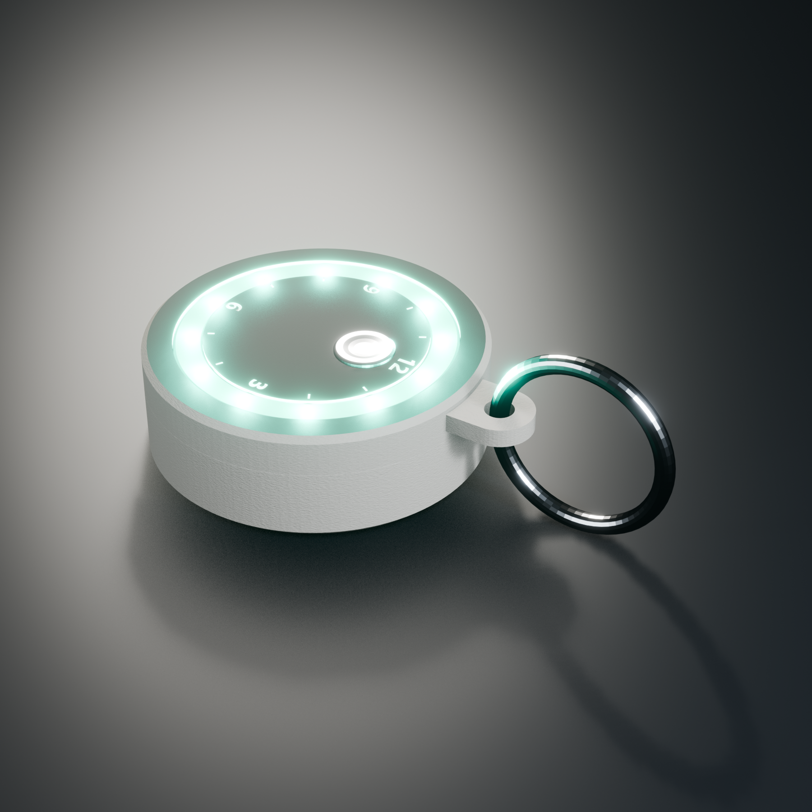

# LED Watch — enclosure and mechanical fit (v1)

A two-piece, key-ring enclosure for the ⌀34 mm LED-watch PCB and a ⌀35 × 5.5 mm
round LiPo, with a watch-style dial: **12 / 3 / 6 / 9** engraved into the smoked
top panel and **eight index notches** at the in-between hours.  Everything the
device needs — PCB, battery, foam, two antennas and their keep-outs — is inside
a **⌀40 × 13.5 mm** body (14.25 mm to the top of the button).  The goal is a
volume proof, not a production-ready mechanism.



| View | File |
|---|---|
| 3/4 hero, light ring lit, dial | `render/hero_3quarter.png` (1800²) |
| Top view, light ring lit, dial | `render/top_view.png` (1600²) |
| USB-C side | `render/usbc_side.png` (1700×1300) |
| In a hand, for scale | `render/hand_scale.png` (1800×1350) |
| Exploded fit view | `render/exploded_view.png` (1500²) |
| Dimensioned technical sheet | `render/technical_drawing.png` / `.svg` (A3, 2:1) |
| Editable scenes | `render/led_watch_hero.blend`, `render/led_watch_exploded.blend`, `render/led_watch_hand.blend` |

The hand image uses a stylised mannequin hand built procedurally in Blender
(the asset libraries and generators available to this session were all
switched off); it is a scale reference, not a photoreal hand.

---

## 1. Source data extracted from KiCad

Exported with `kicad-cli` from `led_watch.kicad_pcb`:

| File | What |
|---|---|
| `exports/positions.csv` | pick-and-place: ref, value, X/Y, rotation, side |
| `exports/pcb.step` | board + all component 3D models (proxy models added for parts missing from the KiCad library) |
| `exports/pcb.stl` | same assembly as a fine mesh |
| `exports/led_watch_assembly.kicad_pcb` | copy of the board with proxy model paths, used to regenerate the STEP |

`positions.csv` is in KiCad page coordinates (`PosY = −kicad_y`).  The mechanical
frame used everywhere below is:

```
origin = board centre
+Y     = 12 o'clock (button / key-ring lug side)
Z = 0  = PCB solder (back) face;  Z = 1.60 = PCB front face
```

### Measured component positions and heights

| Ref | Part | Board XY (KiCad) | Mech XY (mm) | Envelope / height |
|---|---|---|---|---|
| J1 | USB-C HRO TYPE-C-31-M-12 | 100, 114 | **0, −14.0** | 8.94 × 7.30 mm, **3.10 mm below** back |
| SW1 | EVQP0N02B tactile switch | 100, 93.5 | **0, +6.5** | 6 × 6 mm, **2.50 mm above** front |
| U1 | nRF9151-LACA | 100, 103.5 | 0, −3.5 | 12.1 × 11.1 × 0.90 mm |
| U2 | 1NCE MFF2 eSIM | 100, 100 | 0, 0 | 5 × 6 × 0.60 mm (back) |
| J2 / J3 | U.FL (LTE / GNSS) | 86 / 114, 100 | −14 / +14, 0 | 3.1 × 3.0 mm, 1.25 mm below back |
| L1–L12 | WS2812B-2020 | ring | r = **14.3**, every 30° from +Y | 2.0 × 2.0 × 0.65 mm above front |

The tallest back-side part is the USB-C (3.185 mm below the solder face); the
tallest front-side part is the switch (2.50 mm above the front face).  Both are
used as hard envelopes in the housing.

---

## 2. Stack-up

All values in millimetres, assembly frame.

| Layer | Z range | Notes |
|---|---:|---|
| Bottom cover outside | −9.10 … −0.20 | 0.8 mm bottom chamfer |
| Bottom-cover floor | −7.70 | 1.40 mm back wall |
| Battery cushion | −7.70 … −7.45 | 0.25 mm closed-cell pad |
| **LPR553535 battery** | **−7.45 … −1.95** | ⌀35 × 5.5, 96.9 % volume after USB-C notch |
| **0.5 mm foam pad** | **−1.95 … −1.45** | ⌀34.4, 0.5 mm, USB-C notch |
| Back-component air gap | −1.45 … 0 | 0.115 mm under U.FL, 0.8 mm under eSIM, 1.19 mm under USB-C |
| **PCB** | **0 … 1.60** | ⌀34.1, 0.25 mm radial clearance to bezel |
| Top components | 1.60 … 4.095 | switch is the tallest |
| **Light ring** | **2.70 … 4.18** | 1.48 mm translucent light pipe, r 13.05–16.35 |
| Bezel top plate | 4.20 … 4.40 | 0.20 mm cover over the switch, window over the ring |
| Button cap top | 5.15 | 0.80 mm cap + 0.30 mm pre-travel gap |

The PCB is located radially by the bezel (inner ⌀34.60) and supported vertically
on **three ledges** in the bottom cover at 0°, 120° and 240° (a 6 o'clock ledge
would collide with the USB-C).  The 0.5 mm foam pad sits on the battery top; the
PCB itself does not rest on the foam, it rests on the ledges so back-side
components are not loaded.

---

## 3. Housing design

| Feature | Detail |
|---|---|
| Outer size | ⌀40.0 mm; 13.5 mm body height; 14.25 mm to button top |
| Key-ring lug | 8 mm wide, 2.2 mm thick, ⌀3.4 mm hole at y = +24; overall length 48 mm |
| Split line | z = −0.20, V-groove from 0.22 mm chamfers on both shells |
| Joint | 4 × cantilever snap hooks on the bezel at 45/135/225/315°, into pockets in the cover inner wall |
| Radial tolerance | **0.25 mm** (bezel R17.30 vs PCB R17.05; battery cavity R17.75 vs cell R17.50) |
| USB-C cutout | 9.8 mm wide × ≈3.6 mm tall opening straddling the seam at 6 o'clock |
| Button | Ø5.4 mm hole in the top plate; Ø4.8 mm stem, Ø7.0 mm dished cap |
| Light ring | 1.48 mm tall translucent annulus, top 0.22 mm below the bezel face; 12 LED pips reproduced in the render |
| Dial markings | **12 / 3 / 6 / 9** engraved 0.15 mm at r 11.60, 2.0 mm cap height; **8 index notches** (0.80 × 0.22 × 0.12 mm) at 30°/60°/120°/150°/210°/240°/300°/330°; 0.40 mm dial land r 10.20–13.00 |
| Surface finish | matte, lightly textured polymer (render uses a fine procedural bump) |
| Wall thickness | 2.25 mm at the battery, 2.70 mm around the PCB |

The dial land is deliberately 0.40 mm thick: the switch corner reaches r 9.96,
so the land starts at r 10.20 and the 0.15 mm engraving leaves 0.25 mm of
material.  The numerals are filled with a pale lume material in the renders.

The button plunger is over **SW1 at (0, +6.5)**, not at the geometric centre.
The nRF9151 occupies the centre of the board, so a centred 6 mm switch is not
possible without a smaller switch and a larger PCB — this is carried over from
the PCB design.

---

## 4. Antennas and keep-outs

The PCB uses **U.FL connectors**, not ceramic chip antennas (the PCB design notes
explain why: chip antennas need a VNA-tuned matching network).  Modelling a chip
antenna that the board does not have would not prove anything, so the enclosure
carries the antennas the board actually uses:

* **LTE**: flex antenna, 80° arc at 180° (left side), r 16.90–19.10, z 3.87–4.05,
  0.18 mm thick.
* **GNSS**: same, 80° arc at 0° (right side).
* Each sits in a 0.30 mm-deep pocket machined into the underside of the bezel's
  top annulus, leaving 0.30 mm of plastic above.
* **Ground-plane keep-out volumes** are r 16.60–19.40, z 1.70–3.85, 86° arcs.
  They sit above the PCB (top of PCB = 1.60) and a long way above the battery.

Both keep-outs are verified against the PCB and battery solids: **0 mm³
intersection**.  A real RF layout would still need matching and a proper ground
keep-out on the PCB itself; this is a volumetric proof only.

---

## 5. Interference verification

Every pair was checked as a Boolean `common` in FreeCAD.  A touching face gives
0 mm³; any real overlap would be non-zero.

| Pair | Intersection (mm³) |
|---|---:|
| case_top × PCB assembly | **0.000** |
| case_bottom × PCB assembly | **0.000** |
| case_top × battery | **0.000** |
| case_bottom × battery | **0.000** |
| PCB × battery | **0.000** |
| PCB × foam pad | **0.000** |
| battery × foam pad | **0.000** |
| PCB × LTE keep-out | **0.000** |
| PCB × GNSS keep-out | **0.000** |
| battery × LTE keep-out | **0.000** |
| battery × GNSS keep-out | **0.000** |
| case_top × light ring | **0.000** |
| case_bottom × light ring | **0.000** |
| case_top × button | **0.000** |
| light ring × button | **0.000** |

Machine-readable copy: `verification.json`.

The exported meshes are watertight:

| Part | Triangles | Volume (mm³) | Non-manifold edges |
|---|---:|---:|---:|
| case_top.stl | 8 510 | 1 690 | 0 |
| case_bottom.stl | 2 726 | 3 647 | 0 |
| button.stl | 1 208 | 30.3 | 0 |
| light_ring.stl | 1 182 | 445 | 0 |

All STLs were exported at **0.015 mm linear deflection** (angular 0.25 rad),
i.e. under the requested <0.02 mm.

---

## 6. Battery

Reference solid: **LPR553535 round LiPo, ⌀35 × 5.5 mm**, with 0.55 mm edge breaks.
A rectangular notch 12 mm wide × 1.50 mm deep is cut at 6 o'clock to clear the
USB-C body.  This leaves 5 128 mm³ of the 5 292 mm³ nominal cell volume — about
**581 mAh-equivalent** (96.9 % of 600 mAh).  The notch is a modelling assumption;
a production cell would be specified with the notch or replaced by a slightly
smaller cell.

---

## 6b. Dimensioned technical sheet

`render/technical_drawing.png` (3308 × 2338, 200 dpi) and `.svg` are generated
from the same parameters by `scripts/draw_technical.py`.  The sheet is A3
landscape, **2:1**, third-angle, and carries:

* **Top view** — Ø40.0, 48.0 overall, 8.0 lug width, Ø3.4 lug hole, light ring
  Ø32.7 / Ø26.1, button Ø7.0 at 6.5 from centre, dial markings.
* **Front view (USB-C side)** — 40.0 width, 13.5 body height, 14.25 overall,
  seam 4.6 below the top, USB-C opening 9.8 × 3.65, bottom offset 5.75.
* **Right side view** — 48.0 overall, 8.0 lug extension, 2.2 lug thickness,
  Ø3.4 hole hidden, 13.5 height.
* **Bottom view** — Ø40.0, 9.8 USB-C opening, Ø35.5 battery cavity (internal).
* **Schematic stack-up** — 1.4 back, 0.25 cushion, 5.5 LiPo, 0.5 foam, 1.45 gap,
  1.6 PCB, 1.1 cavity, 1.48 ring, 0.22 plate.
* Notes, third-angle symbol and title block.

## 7. Assumptions and limits

1. **Battery notch** for the USB-C: if the cell cannot be notched, the PCB must
   sit ≈1.5 mm higher (body grows to ≈15 mm) or the connector moves.
2. **Foam gap**: 0.5 mm pad on the battery, plus component clearance.  The PCB is
   supported by the cover ledges, not by the foam.
3. **Snap-fit** is nominal geometry only — no tolerance stack, FEA or fatigue
   analysis.  Print in PA12/MJF or mould in ABS/PC-ABS and tune the beads.
4. **Light ring** is a solid optical placeholder; no ray-trace of the light pipe.
5. **Antennas** are volumetric reference solids; no matching network, efficiency
   or SAR analysis.
6. No gasket, IP rating, draft angles, tooling radii, or drop test.  This is a
   proof of fit, not a manufacturable product.
7. Renders use illustrative materials (bone shell, smoked top panel, brushed
   steel button/key-ring, aqua light pipe).  They are not part of the STL data.

---

## 8. Files

```
mech/
├─ exports/
│  ├─ positions.csv                  KiCad pick-and-place
│  ├─ pcb.step / pcb.stl             board + components
│  └─ led_watch_assembly.kicad_pcb   board copy with proxy model paths
├─ reference/
│  ├─ battery.stl                    ⌀35 × 5.5 LPR553535
│  ├─ foam_pad.stl                   0.5 mm die-cut pad
│  ├─ antenna_lte.stl                flex antenna, 180°
│  ├─ antenna_gnss.stl               flex antenna, 0°
│  ├─ keepout_lte.stl                LTE ground-plane keep-out
│  ├─ keepout_gnss.stl               GNSS ground-plane keep-out
│  └─ proxies/                       simplified STEPs for the missing library models
├─ case/
│  ├─ case_top.stl                   bezel + light-ring window + antenna pockets
│  ├─ case_bottom.stl                battery cup + snap pockets + USB-C notch
│  ├─ button.stl                     plunger + dished cap
│  └─ light_ring.stl                 1.48 mm light pipe
├─ led_watch_enclosure.FCStd         parametric FreeCAD document
├─ verification.json                 dimensions + interference + dial results
├─ scripts/                          rebuild scripts + technical-sheet generator
└─ render/
   ├─ hero_3quarter.png              hero 3/4, ring lit, dial
   ├─ top_view.png                   top, dial + 12 LED pips
   ├─ usbc_side.png                  USB-C side
   ├─ hand_scale.png                 stylised hand, for scale
   ├─ exploded_view.png              exploded fit view
   ├─ technical_drawing.png / .svg   dimensioned A3 sheet, 2:1
   └─ *.blend                        editable hero / exploded / hand scenes
```

## 9. Regenerating

```bash
# from led_watch/, with KiCad 10 and FreeCAD 1.1
export KICAD10_3DMODEL_DIR='C:\Program Files\KiCad\10.0\share\kicad\3dmodels'
kicad-cli pcb export step --subst-models -o mech/exports/pcb.step mech/exports/led_watch_assembly.kicad_pcb
kicad-cli pcb export stl  -o mech/exports/pcb.stl  mech/exports/led_watch_assembly.kicad_pcb
kicad-cli pcb export pos --format csv --units mm --side both -o mech/exports/positions.csv led_watch.kicad_pcb

freecadcmd mech/scripts/build_enclosure.py     # STLs + FCStd + verification.json
python3 mech/scripts/draw_technical.py          # A3 dimensioned sheet (PNG + SVG)
```

`scripts/make_proxies.py` creates the WS2812B-2020, USB-C, nRF9151 and MFF2
proxies; `scripts/patch_board_models.py` points a copy of the board at them.
`build_enclosure.py` is the single parametric source for all case dimensions.
